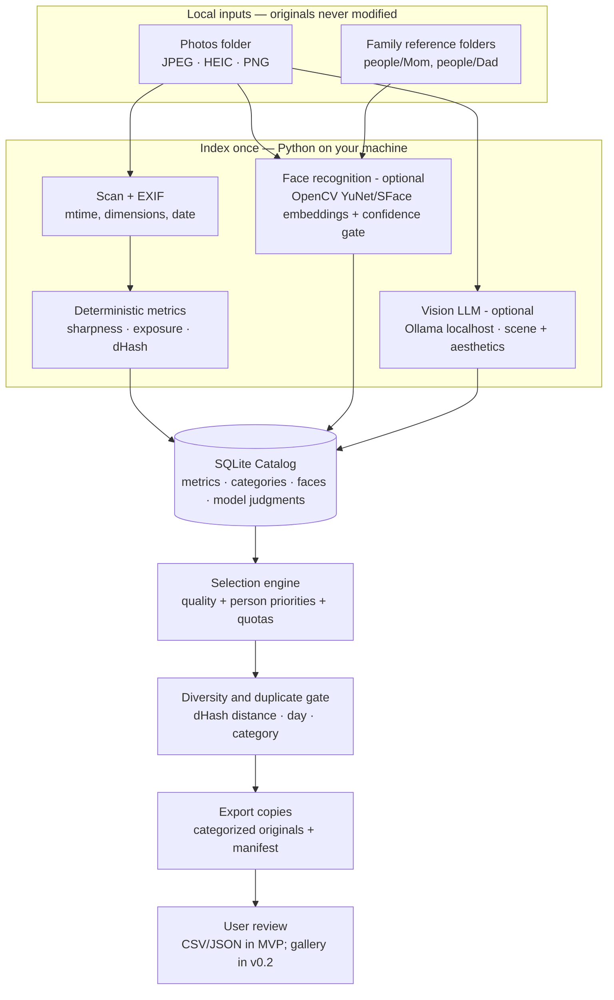
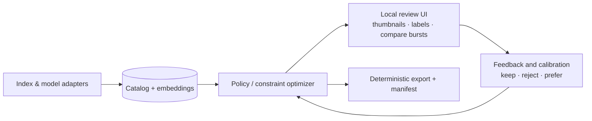

# Architecture — v0.1 and target design

## Runtime data flow



## Selection sequence

```mermaid
sequenceDiagram
  actor User
  participant CLI
  participant DB as SQLite
  participant AI as Local models
  participant Select as Selector
  participant FS as Filesystem

  User->>CLI: scan photos/ [--vision] [--faces]
  CLI->>DB: compare path, mtime_ns, size, model revisions
  alt uncached or changed
    CLI->>FS: read photo (never mutate)
    CLI->>AI: optional face / vision inference
    AI-->>CLI: person matches / structured judgment
    CLI->>DB: upsert metrics + model signals
  else cached
    DB-->>CLI: reuse prior results
  end
  User->>CLI: select --count 100 --weights ...
  CLI->>DB: load indexed photos
  CLI->>Select: rank, quotas, dedup, diversity
  alt feasible N-photo selection
    Select-->>CLI: ordered shortlist and reasons
    CLI->>FS: copy originals into new export directory
    CLI->>FS: write manifest.csv + manifest.json
  else impossible quotas or insufficient diversity
    Select-->>User: explicit error; no export
  end
```

## Responsibility boundaries

| Component | Owns | Why |
| --- | --- | --- |
| `analyzer.py` | file ingest, EXIF rotation, image scores, 64-bit hash | Fast, reproducible baseline |
| `faces.py` | enrollment, embeddings, match confidence | Identity is **not** inferred by the vision LLM |
| `vision.py` | schema-guided local image descriptions/scores | Subjective visual understanding; never hard constraints |
| `catalog.py` | SQLite cached analysis, manual labels | Re-select without re-inference |
| `selector.py` | exact count, family importance, quotas, diversity | Rule enforcement in code instead of trusting model output |
| `exporter.py` | copy originals + audit manifests | Non-destructive and reversible |
| `cli.py` | orchestration and validation | Thin command surface |

## Catalog artifact

`photos` (one row per absolute source path): file identity `(size_bytes, mtime_ns)`, dimensions/date, `dhash`, deterministic metrics, inferred face IDs and confidence, user-assigned labels, category, caption, vision score/model ID, face-enrollment revision. `people` stores normalized reference embeddings keyed by display name. Local SQLite is private biometric metadata: do not push to Git.

## Decisions and tradeoffs

1. **SQLite instead of vector DB** in v0.1. At thousands/tens of thousands of images, per-image metadata is small and a simple db is enough. Add embeddings and an ANN index only if semantic retrieval matters.
2. **Model is a feature generator, not a planner.** LLM numerical grades are approximate; can be reranked but cannot override user quotas or move files.
3. **Face detection != family recognition.** Enrollment provides explicit identities; uncertain matches remain unknown.
4. **Offline-first with explicit first-time model downloads.** Explicit model downloads need internet to install, but photos and model inference remain local.
5. **Copy, don't delete.** Source photos and EXIF remain intact. Export folder must not already exist.

## Target v0.2+ architecture



## Data handling

- Local file paths and face embeddings are personal information. Store the database under the user's home directory and restrict local file-system permissions if sharing the machine.
- First-run dependencies and model downloads may involve network access; this is not an air-gapped installation.
- Images are sent to Ollama only via `localhost` and are downsized JPEGs for inference. Originals never leave the local file system through this project's code.
- YuNet/SFace model weights are downloaded explicitly and carry their own open-source licenses (MIT/Apache-2.0).
